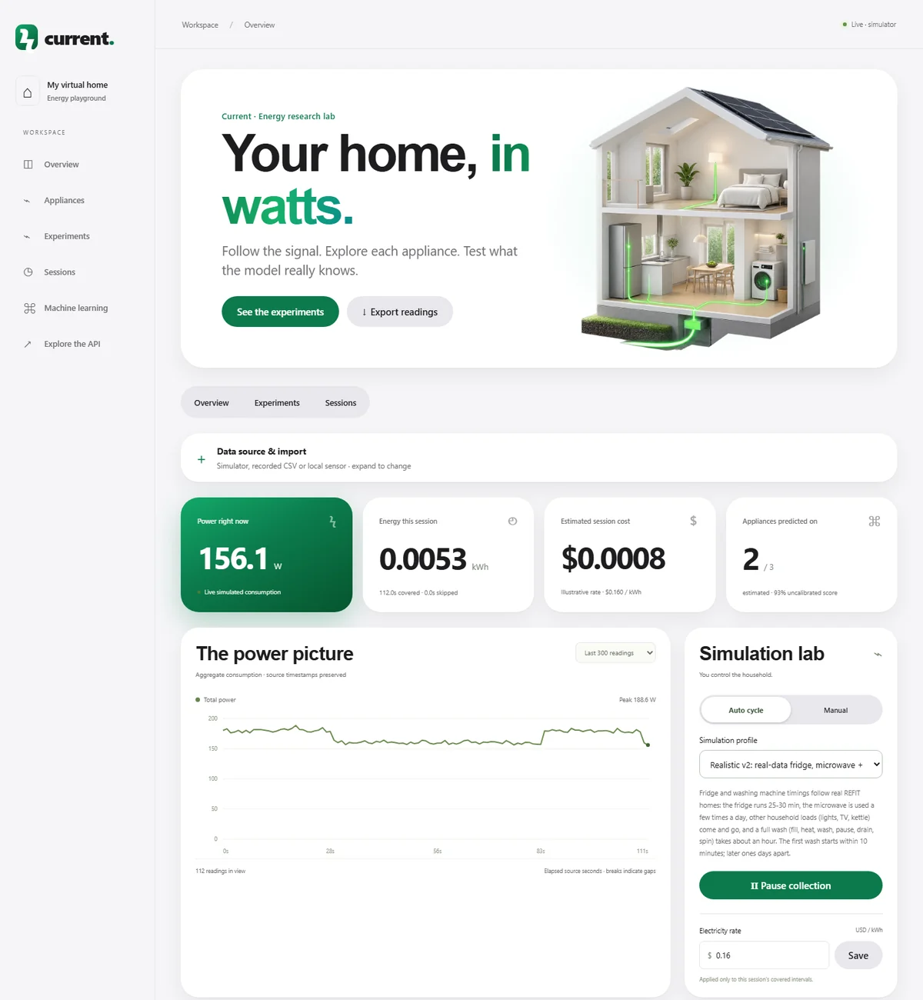

# Current: an energy profiler

Current watches a home's total electricity use and tries to figure out which
appliances are running, using nothing but that one power reading. It runs as a
live dashboard on your own computer, fed by either a simulator or real household
recordings.



I started this to learn how machine learning works on real sensor data, and it
turned into a small research project. The main thing I learned is that a model
can look great on one house and fall apart on the next one, so I wrote down every
experiment's rules before running it and kept the results that went badly.

**[Read the report](docs/report.md)** ([PDF](docs/report.pdf)) ·
**[Project page](https://saqlinea.github.io/energy-profiler/)** ·
[All experiment write-ups](#experiment-write-ups)

## What I found

Most of the work is about detecting the refrigerator from whole-house power,
using real homes from the public [REFIT dataset](https://zenodo.org/records/5063428).
F1 is the score: 1.0 means the model finds every period the fridge is on with no
false alarms, and 0 means it never finds them.

| Result | Data | F1 | What it means |
|---|---|---:|---|
| Fixed a timing bug before any modelling | REFIT House 1 | n/a | Only 8 usable windows at 8 s; a 16 s rule gave 4,368 |
| Best model on the development house | Trained on Houses 1, 3, 4, tested on House 2 | **0.781** | Looked like a working fridge detector |
| **Same model on an unseen house (scored once)** | Tested on House 5 | **0.297** | The development score did not carry over |
| Simulator-trained model, same unseen house | Simulated homes, tested on House 5 | **0.686** | The simulator beat training on real houses |
| Always-off baseline | House 5 | 0.000 | What "no skill" looks like |
| Every house held out once | Houses 1–5, real training | **0.339–0.520** | The score depends a lot on which home you test |
| Same rotation, simulator-trained | Simulated homes, each of Houses 1–5 | **0.280–0.874** | Better detection in 4 of 5 homes, but often worse power estimates |
| Washing machine (simulated only) | Simulated homes | 0.701 | Finds the heating phase, misses the low-power phases |

Details for each result: [final test](docs/final-test.md) ·
[every-house follow-up](docs/cross-house.md) ·
[fridge development](docs/fridge-development.md) ·
[washer experiment](docs/washer-experiment.md).

**Limits.** These are short slices of REFIT (about a day per house), one random
seed and five houses. Nothing has been tested on a physical sensor yet. It's a
learning and research project, not a billing meter or a safety device.

Built with Python, FastAPI, SQLite, scikit-learn and plain HTML/CSS/JS (no build
step), with 80 automated tests.

## Running it

You need Python 3.11 or newer.

```powershell
python -m venv .venv
.\.venv\Scripts\python.exe -m pip install -r requirements.txt
.\.venv\Scripts\python.exe app.py
```

Then open http://127.0.0.1:8000. Restart the server after changing Python code;
just refresh the page after changing anything in `static/`.

The app has no login, so it only listens on your own computer. Don't expose it to
the internet.

**GitHub Codespaces.** You can also run it in a Codespace (Code → Codespaces →
Create). Start it with `python app.py`, then open Ports → 8000 in the browser and
keep the port **Private**. Use `python app.py` rather than a plain `uvicorn`
command, because it sets up the proxy handling Codespaces needs. Codespaces has
usage limits, so stop it when you're done. Your local data isn't uploaded, and
anything created in a Codespace stays there unless you download it.

## Things to try

1. Watch the simulator for a bit. Predictions start after five readings, and the
   switches let you turn appliances on and off by hand.
2. Under **Choose your data**, load `examples/replay-demo.csv` with interval 1,
   then press **Replay CSV / restart**. This file is a small made-up example, not
   a real home. Notice that the blank reading and the time gap don't turn into
   zero watts; the chart just breaks there.
3. Compare the measured watts with the model's estimates. Unknown labels stay
   unknown instead of being treated as off.
4. Check the per-appliance scores (precision, recall, F1, power error, energy
   error) next to the two baselines.
5. Open **Experiments** to look through saved results. Each one is labeled with
   whether it was trained and tested on real or simulated data, and shows an
   on/off strip, actual vs. predicted watts and the error over time.

The demo file is too short to train on. For that you need a longer labeled
recording.

## How it works

```text
simulator.py or a CSV recording (sources.py)
        ↓  timestamps, total watts, optional per-appliance labels
app.py: picks the source, checks for gaps, keeps the last 5 readings
        ↓
features.py: watts, change, mean, variation, minimum, maximum
        ↓
ml.py: chance each appliance is on, plus estimated watts
        ↓
storage.py: saves the reading, the truth, the prediction and the model version
        ↓
FastAPI → static/app.js dashboard

offline: prepare_recording.py → evaluate.py → saved model + JSON report
```

A few rules I kept throughout:

- The model only ever sees total power. Appliance labels are used for scoring,
  never as inputs.
- It predicts the latest reading using only past readings, never future ones.
- A gap in the data is a gap. Nothing gets filled in, and missing values stay
  blank instead of becoming zero.
- The model can say "not sure" when a reading is outside what it was trained on.
  That's a rough rule of thumb, not a calibrated probability.

The live model is a multi-output random forest. A simpler one-watt classifier and
an always-off model stay around as baselines.

## Using your own recording

Get a dataset you're allowed to use (this repo doesn't include or download
REFIT, UK-DALE or REDD). Check the dataset's documentation for which column is
which appliance, and use **active power in watts**.

The app reads this CSV format:

```csv
timestamp,total_watts,lamp,refrigerator,microwave
2026-01-01T00:00:00Z,160,10,150,0
2026-01-01T00:00:01Z,161,11,150,0
```

- `timestamp` and `total_watts` are required; the appliance columns are optional.
- Leave a cell blank when you don't know the value. Only write `0` when the meter
  really read zero.
- Timestamps need a timezone and have to go strictly forward.
- One home per file. Up to 5 MB or 50,000 rows.

If your columns are named differently, `prepare_recording.py` converts them (the
column names below are just examples):

```powershell
.\.venv\Scripts\python.exe prepare_recording.py source.csv recording.csv --timestamp Time --timestamp-format unix --mains Aggregate --refrigerator FridgeMeter --limit 10000 --origin "Dataset name; house"
```

It checks the result, won't overwrite an existing file, and writes a small
metadata file recording where the data came from. Use `--scale 1000` only if
every power column is in kW.

## Testing models fairly

Training never touches the test data:

- **Simulated:** 60 training homes and a fixed set of 20 test homes.
- **Recorded:** the recording is split 70/30 by time before anything else, and
  no window crosses the split or a gap.
- **Best option:** train on one house and test on a completely different one.

```powershell
# Simulated benchmark
.\.venv\Scripts\python.exe evaluate.py --output data/experiments/synthetic

# One labeled recording, split by time, sampled every 8 seconds
.\.venv\Scripts\python.exe evaluate.py --csv recording.csv --cadence 8 --output data/experiments/recorded

# Train on one house, test on another
.\.venv\Scripts\python.exe evaluate.py --csv training-house.csv --test-csv heldout-house.csv --cadence 8 --output data/experiments/heldout
```

Every report saves the data hashes, the split, the features, the settings and the
model version, so results can be checked later. One thing I learned the hard way:
if you keep testing on the same house while tuning, you end up tuning to that
house. Keep a final house untouched until the very end.

What the scores mean:

- **Precision:** when the model says "on", how often it's right.
- **Recall:** how many of the real "on" periods it catches.
- **F1:** a balance of the two.
- **MAE:** average error in estimated watts.
- **Energy error:** difference between predicted and measured kWh, counted only
  over stretches without gaps.

Energy uses the trapezoid rule and skips any interval with a missing reading or
a gap longer than 1.5 times the sample interval.

## Data and saved models

- Readings are stored in `data/readings.sqlite3`. Older databases are upgraded
  in place without losing rows.
- Trained models are saved in `data/models/` with a checksum, and the app checks
  it on startup. **Never load a model file you downloaded from somewhere else**,
  because model files can run code.
- `data/`, recordings, models and logs are all kept out of Git.

## API

| Endpoint | What it does |
| --- | --- |
| `GET /api/dashboard` | Current state and history (supports incremental updates) |
| `GET /api/state`, `GET /api/readings` | State, or this session's readings |
| `POST /api/replay?cadence=1&name=recording.csv` | Upload a CSV to replay |
| `POST /api/source` | Switch between `replay` and `simulator` |
| `POST /api/simulation` | Pause or resume, auto or manual mode |
| `POST /api/appliances/lamp` | Turn the simulated lamp on or off |
| `POST /api/tariff` | Set the electricity price used for cost estimates |
| `POST /api/model/train` | Train on `synthetic` or `recorded` data |
| `GET /api/model/report` | The current model's test results |
| `GET /api/export.csv` | Download every saved session |

Interactive docs are at http://127.0.0.1:8000/docs while the app is running.

## Tests

```powershell
.\.venv\Scripts\python.exe -m unittest -v
node --check static/app.js
```

The tests use temporary databases and cover replay, gaps, blank labels, timing,
data splits, baselines, saving and loading models, and database upgrades. Node
is only needed for the JavaScript syntax check.

## Experiment write-ups

- [REFIT first look](docs/refit-first-look.md) and [extended REFIT check](docs/extended-refit-check.md)
- [Fridge development v1–v4](docs/fridge-development.md)
- [Final House 5 test](docs/final-test.md)
- [Every-house follow-up](docs/cross-house.md)
- [Simulator fridge v2](docs/simulator-fridge-v2.md)
- [Washing machine profile](docs/washing-machine-profile.md) and [simulator design](docs/washing-machine-design.md)
- [Reading the dashboard charts](docs/experiment-visualization.md)
- [Sending readings from a home sensor](docs/sensor-setup.md) (software only; no hardware tested yet)
- [Software roadmap](docs/software-roadmap.md)

## Credits

These projects shaped how I approached the problem. None of their code is
copied or bundled here.

- [NILMTK](https://github.com/nilmtk/nilmtk) and [NILMTK-contrib](https://github.com/nilmtk/nilmtk-contrib): data handling and evaluation
- [goruck/nilm](https://github.com/goruck/nilm): per-appliance pipeline
- [Emoncms](https://github.com/emoncms/emoncms): handling missing data
- [NILMbench](https://github.com/nilmtk/nilmbench): fixed test splits

## What's next

Recording real data with smart plugs (no mains wiring), testing on more REFIT
houses, comparing against a published deep-learning baseline, and connecting a
real sensor through the same input the simulator uses.
