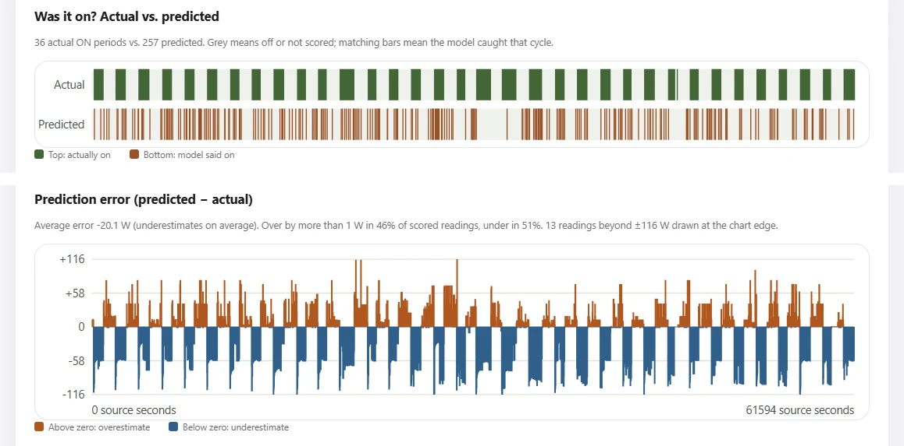

# Does Appliance Detection Transfer Between Homes? A Preregistered Test with REFIT Data

**Current, an energy profiler** · SaqlineA · October 2026 ·
Code and data pipeline: <https://github.com/SaqlineA/energy-profiler>

## Abstract

Non-intrusive load monitoring (NILM) tries to work out which appliances are
running from a home's total electricity use. I built Current, a small NILM lab
with tests. It has a household simulator, replay of real recordings from the
REFIT dataset, simple tree-based models, and a dashboard that labels every result
by whether it was trained and tested on real or simulated data.

I focused on detecting when the refrigerator is running. Before scoring anything,
I wrote down the protocol, the model and the pass/fail rule, and I kept one REFIT
house (House 5) completely unscored until the end.

My best development model, trained on three real houses, reached F1 0.781 on a
fourth house. On the untouched House 5 it dropped to **F1 0.297**. A model
trained only on simulated homes scored **F1 0.686** on the same house. Both
underestimated the fridge's energy by 34 to 41%. I then ran a second
preregistered test that held out each of Houses 1 to 5 in turn. With real
training, F1 ranged from 0.339 to 0.520 depending on which house was held out,
and the simulator model detected the fridge better in 4 of the 5 houses, though
its power estimates were often worse. The development house made my model look
far better than it really was on a new home, and that was the biggest surprise
of the project.

## 1. Background and question

NILM is appealing because one meter is cheaper and less intrusive than putting a
sensor on every appliance (Hart, 1992). It's also hard. Appliances overlap, the
same kind of appliance draws different power in different homes, and models tend
to learn the household they were trained in instead of the appliance.

The REFIT dataset (Murray et al., 2017) records whole-house ("aggregate") power
and separately metered appliances in 20 UK homes. That made it a good place to
test one question:

> *Does training on several real households generalize to an unseen household
> better than training on simulated appliance behaviour?*

## 2. System

Current is a Python application (FastAPI, scikit-learn, SQLite) with a plain
HTML, CSS and JavaScript dashboard.

Simulated readings, replayed recordings and live sensor readings all go through
the same pipeline: timing checks, features over a trailing window, model
estimates, storage and the dashboard. Features only use the current and earlier
readings, so nothing leaks in from the future, and the appliance ground truth is
used only for scoring, never as a model input. Real timestamps and gaps are kept
as they are. Nothing is interpolated, and a blank label means unknown, not zero.

There are 80 automated tests covering timing, energy integration, storage,
experiment records, the simulators and the sensor interface. A local endpoint can
also accept batched readings from a future ESP32 sensor with a token, but I
haven't tested any physical sensor yet.

Later I calibrated the simulator against REFIT Houses 1 to 4. The first version's
fridge switched on and off every few minutes; I changed it to about 85 W, running
25 to 30 minutes on and 1 to 2 hours off. I also added a washing machine with
several stages and more realistic background loads, and checked each change
against realism targets I had written down first.

## 3. Method

**Data split, fixed before scoring.** Each partition is a fixed slice of 10,000
readings (about one day), with a SHA-256 hash recorded so it can't quietly
change. Training started with REFIT House 1 and later used Houses 1, 3 and 4.
House 2 was the development house. House 5 was the final test: I checked that
its files were intact but didn't parse or score it until the very end.

**Target and models.** The target is whether the refrigerator is on (20 W or
more on its own meter) and how many watts it draws. I compared three models: an
always-off baseline, a Decision Tree with depth 8, and a Random Forest with 40
trees. I didn't do any hyperparameter search.

**Metrics.** F1 measures how well a model detects the ON periods. Accuracy alone
is misleading here, because a fridge is off most of the time, so a model that
always says "off" looks decent. I also report MAE in watts, and estimated versus
measured energy, counted only over stretches where the timing was valid.

**Preregistration.** For each experiment I committed the protocol, the single
change being tested and the decision rule to Git before running it. Each one ran
once. When something failed, I recorded the failure instead of tuning until it
passed.

## 4. Development: what had to be fixed

**Timing came first, before any modelling.** House 1's readings arrive in bursts,
with gaps of 1 to 2 seconds alternating with gaps of 12 to 14 seconds. Under a
strict 8-second rule there were only **8** training windows, all with the fridge
off (v1). I switched to a rule that keeps the first real reading at least 12.8
seconds after the previous one, which gives a 16-second cadence and doesn't look
at the labels. That produced **4,368** windows containing both classes (v2). The
rule never creates or changes values, so I could later apply it to House 5
without looking at House 5.

**Then the features.** Summary features in raw watts mistook House 2's different
background load for the fridge. Measuring features relative to the lowest
household total over the previous 30 minutes (v3) removed most of those false
alarms. Adding Houses 3 and 4 to training (v4r) then improved every metric.

**Table 1.** Development results on House 2 (3,867 windows; 1,256 fridge-on).

| Run | Features | Trained on | Model | F1 | Accuracy | MAE (W) | Est. / measured kWh |
|---|---|---|---|---:|---:|---:|---:|
| v2 | absolute | House 1 | RF | 0.406 | 28.6% | 52.6 | 0.960 / 0.453 |
| v3 | relative | House 1 | RF | 0.181 | 70.7% | 22.0 | 0.143 / 0.453 |
| v4 | absolute | Houses 1, 3, 4 | RF | 0.132 | 66.0% | 28.1 | 0.108 / 0.453 |
| v4r | relative | Houses 1, 3, 4 | RF | 0.439 | 75.4% | 19.7 | 0.303 / 0.453 |
| **v4r** | relative | Houses 1, 3, 4 | **DT** | **0.781** | **87.1%** | **14.8** | **0.386 / 0.453** |
| — | — | — | Always off | 0.000 | 67.5% | 28.3 | 0 / 0.453 |

I picked the v4r Decision Tree as the real-data candidate before House 5 was
opened.

## 5. Final test on House 5 (scored once)

Before reading House 5, I committed three things: the candidate model, a
simulator-trained comparison model (same Decision Tree settings and features,
trained on the research simulator instead), and the pass/fail rule.

The real-data model would pass only if its F1 beat the always-off baseline, its
MAE was lower than always-off, and its energy estimate landed between 0.5 and 1.5
times the measured energy. It would count as "better than the simulator" only if
its F1 was higher, its MAE lower and its energy ratio closer to 1.

**Table 2.** House 5 final test (4,335 identical windows; 1,956 fridge-on).

| Model | F1 | Precision | Recall | MAE (W) | Est. / measured kWh |
|---|---:|---:|---:|---:|---:|
| Real-trained DT (Houses 1, 3, 4) | 0.297 | 0.557 | 0.202 | 38.9 | 0.480 / 0.819 (0.59×) |
| **Synthetic-trained DT** | **0.686** | **0.769** | **0.620** | 39.4 | 0.539 / 0.819 (0.66×) |
| Always off | 0.000 | — | 0.000 | 48.5 | 0 / 0.819 |

**Result.** The real-data model passed, barely, but it was **not** better than
the simulator-trained model.

**Figure 1.** House 5 in the dashboard. The top strip shows 36 real fridge
cycles, with the real-trained model's 257 short, scattered "on" guesses below
them. The bottom chart shows the prediction error: the model underestimates
during every real cycle and overestimates in between.

## 6. Follow-up: every house held out once

One test house can't tell you whether a result is a general pattern or just a
quirk of that house, so I preregistered a second test and committed the protocol
before running it. Each of Houses 1 to 5 is held out in turn, and a Decision Tree
with the frozen v4r settings is trained on the other four. Each round also scores
the frozen simulator model and always-off on the same windows.

This measures how much the results change from home to home. It isn't a sealed
test, since House 2 was used to choose the settings and House 5 had already been
scored.

| Held-out house | Real F1 | Simulator F1 | Real MAE (W) | Simulator MAE (W) | Always-off MAE (W) |
|---|---:|---:|---:|---:|---:|
| 1 | **0.358** | 0.280 | 26.9 | 40.0 | **15.7** |
| 2 | 0.520 | **0.874** | 15.0 | **14.8** | 28.3 |
| 3 | 0.377 | **0.631** | 44.9 | 56.0 | **43.9** |
| 4 | 0.339 | **0.360** | 34.2 | 82.5 | **11.2** |
| 5 | 0.450 | **0.686** | **38.9** | 39.4 | 48.5 |
| Mean | 0.409 | 0.566 | | | |

**Table 3.** Fridge detection with each house held out once, 3,687 to 4,368
windows per house.

**Result, judged by the preregistered rules.** Real training did **not** transfer
reliably: it beat always-off on both F1 and MAE in only 2 of the 5 houses. The
simulator's advantage in detection **held**, with a higher F1 in 4 of 5 houses.
Power was a different story. The simulator model had the worst power error of
the three in Houses 1, 3 and 4, and it overestimated House 4's fridge energy
7.7 times over.

So the simulator seems to teach a model *when* a fridge runs better than *how
much* power it draws. The real-training scores also depended on which houses went
into training: adding House 5 dropped House 2 from 0.781 to 0.520.

## 7. Discussion

**The development score didn't carry over.** Recall fell from 71% on House 2 to
20% on House 5. I chose the model after five comparisons on one development
house, and that made it look better than it was. House 2 may also just be an
easy house. When I profiled the houses, House 2 was the only one whose total
clearly rose (by about 86 W) when the fridge switched on. In Houses 1, 3 and 4
the total barely moved (a median rise of 0 to 32 W), so the real training data
had a weak switch-on signal. I measured this, but I haven't tested what causes
it.

**Why might simulated training transfer better?** The simulator's fridge makes
clean, consistent steps. Real training houses with weak or blurry steps might
teach a model to expect small, unclear signals. This is a guess, not a result. I
didn't profile House 5 before scoring it, and it can't be used as a test house
again.

**A second experiment, on simulated data only,** looked at a washing machine with
several stages (Random Forest, F1 0.701). It caught about three quarters of the
2 kW heating periods but fewer than half of the low-power fill and drain phases.
I had predicted that a longer 8-minute window would help tell the washer apart
from short, kettle-like loads. It did the opposite: F1 dropped for both models.

**Limitations.** There is one final test house, one random seed, and about a day
of data per house. I only studied one appliance type, with simple models. The
cleaned REFIT data may have some values filled in upstream, and whole-house and
plug meters don't always agree. Nothing has been tested on a physical sensor.
The model's confidence scores aren't calibrated, and no prediction passed my
rough uncertainty check.

## 8. Next steps

1. **More houses.** Extend the hold-one-out test from five houses to more of
   REFIT's 20, with longer slices. Then test an idea from Section 6: use the
   simulator to learn timing, plus a small power calibration for each home.
2. **A published baseline,** such as sequence-to-point learning (Zhang et al.,
   2018) through NILMTK (Batra et al., 2014), so these numbers can be compared
   with known methods.
3. **A new sealed test house,** since House 5 has been used.
4. **My own real data, collected safely.** Smart plugs with energy monitoring on
   a few appliances would give per-appliance labels. Plugging several appliances
   into one monitored power strip would give a small "household total" to split
   apart, sent through Current's existing sensor endpoint. No mains wiring
   involved.

## References

- Batra, N. et al. (2014). NILMTK: An open source toolkit for non-intrusive load
  monitoring. *Proc. 5th ACM International Conference on Future Energy Systems
  (e-Energy).*
- Hart, G. W. (1992). Nonintrusive appliance load monitoring. *Proceedings of the
  IEEE*, 80(12), 1870–1891.
- Murray, D., Stankovic, L., & Stankovic, V. (2017). An electrical load
  measurements dataset of United Kingdom households from a two-year longitudinal
  study. *Scientific Data*, 4, 160122. (Data obtained via Zenodo record 5063428.)
- Pedregosa, F. et al. (2011). Scikit-learn: Machine learning in Python. *Journal
  of Machine Learning Research*, 12, 2825–2830.
- Zhang, C., Zhong, M., Wang, Z., Goddard, N., & Sutton, C. (2018).
  Sequence-to-point learning with neural networks for non-intrusive load
  monitoring. *Proc. AAAI Conference on Artificial Intelligence.*
